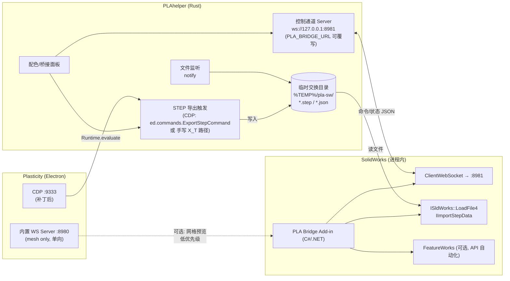
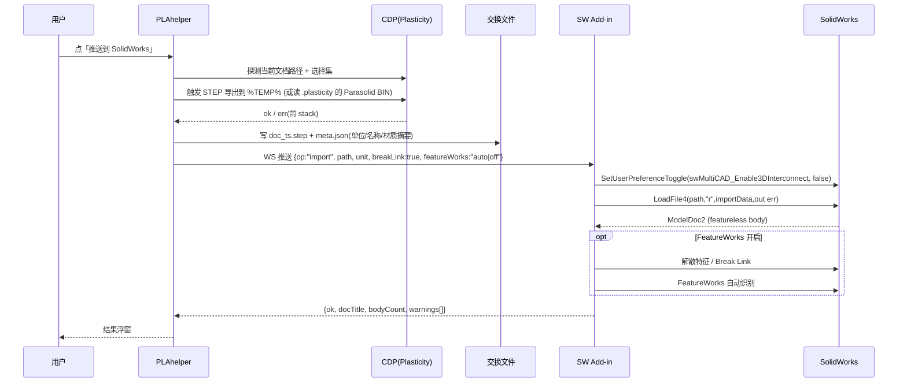

# 可行性逆向调研：3.1 配色/材质方案 · 3.2 步进旋转定制 · 3.3 SolidWorks bridge

- 日期：2026-10-28
- 执行：高见远（架构师）
- 性质：**静态逆向调研**，不写生产代码、不启动 Plasticity GUI
- 证据分级：**【实】=已证实**（有文件/字节级证据）· **【推】=推测**（需运行时复核）· **【验】=待验证**（只能运行时确认，已列入 §6 清单）

---

## 0. 结论速览

| # | 功能 | 结论 | 一句话依据 | 工作量（估） |
|:--|:--|:--|:--|:--|
| 3.1 | 配色 / 材质方案管理 | **部分可行（推荐落地）** | 材质是文档级一等公民（`materials[]` + `nodes[].material`），PBR 全参数，节点/组级挂载；但**运行时改材质的 API 尚未实证**，且材质**不可通过官方 bridge 传递** | 6–9 人日（含 PoC） |
| 3.2 | 步进旋转角度定制 + 方向键绑定 | **可行（且不依赖 CDP）** | ① 角度 = 设置项 `rotateDiscreteIncrement`【实】；② 绑定 = 用户 `keymap.json`（`selector → {keystroke: command}`）【实】；③ 命令族 `orbit:rotate:{up,down,left,right}`【实】 | 1.5–3 人日 |
| 3.3 | SolidWorks bridge | **部分可行（B-rep 单向导入可行，"类 Blender 实时桥"不可行）** | 官方 bridge 只传 **mesh、单向、不传材质**【实】；SW 侧只能收成 **featureless imported body**；真 B-rep 必须走 **STEP**（X_T 因 Parasolid 37 版本过高对多数 SW 不可读） | 12–20 人日（含 C# addin） |

> 三条结论的共同前提：**CDP 恢复后必须跑一遍 §6 待验证清单**。其中 3.1 的落地路径强依赖运行时内省结果，3.2 的推荐路径**不依赖 CDP**，3.3 的推荐路径也**不依赖 CDP**。

---

## 1. 调研方法与证据分级

### 1.1 静态材料清单与可达性

| 材料 | 路径 | 状态 | 能得到什么 |
|:--|:--|:--|:--|
| `app-26.2.3\resources\app.asar` | 108MB，标准 Electron asar（offset 8/12/16 三连 uint32，body 起点 = 16+jsonSize） | **已解包** 369 个文件索引 | 文件清单、配置、图片资源 |
| `app-26.2.3\...\.webpack\main\dot-plasticity\*` | keymap/settings/theme/radials | **已抽取** | 出厂默认（全为 `{}`） |
| `C:\Users\Frank\.plasticity\config\v2\*.json` | 用户真实配置 | **已读取** | keymap / settings（含 **Server 段**）/ theme |
| `app-26.2.3\...\.webpack\renderer\img\*` | 182 个 PNG/EXR | **已枚举** | 内置材质库（35 种）+ 环境贴图 + matcap |
| `app-26.2.3\...\app_window.compiled\index.jsc` | 14MB | **不可读**（见 §1.2） | — |
| `app-26.1.3\...\app_window.compiled\index.jsc` | 12MB，明文 V8 cachedData | **已抽取 49833 条字符串** | 命令表、设置 schema、类/函数名、i18n |
| `app-26.1.3\...\main\index.compiled.jsc` | 2MB，明文 | **已抽取 12797 条字符串** | **默认 keymap 表**、设置 schema、主进程路径 |
| 真实 `.plasticity` 文档 | 4 份（2.1 / 2.5 / 2.8） | **已解析 JSON 头** | **材质数据模型实锤** |

### 1.2 ⚠️ 重大发现：26.2.3 已从"bytenode 明文字节码"升级为**加密容器（PLSEC001）**

```
26.1.3 renderer index.jsc : e6 05 de c0 c0 13 d0 a1 ...   entropy = 5.51 bit/byte  → 明文 V8 cachedData
26.2.3 renderer index.jsc : "PLSEC001" 01 00 8c 00 ...    entropy = 7.999 bit/byte → 加密/压缩
26.2.3 plasticity.jsc.pack: "PLSEC001" 01 00 8c 00 ...    （2.4MB，主进程代码）
26.2.3 .webpack\main\index.js = 14 字节，内容仅 'use strict';
```

- 头部常量：`PLSEC001`(8B) + `0100` + `008c` + 4B 校验/种子 + 4B(2A00 0B00 0800 0E00 恒值) + **4B payload 长度**（renderer=0xD61424≈14MB，pack=0x25BA0C≈2.47MB，与文件实际长度吻合）+ 12B 常量尾部。
- 非 zlib（已试 0–80B 全部偏移）；熵 7.999 → 强加密。依赖表新增 `@noble/ciphers` / `@noble/hashes` / `node-machine-id`，**推测为机器指纹派生密钥**【推】。
- **影响**：
  1. 主进程明文 `index.js` 在 26.2.3 里**根本不存在**（只是 14 字节桩），所以"前置拼接注入"这条老补丁路线**在 26.2.3 结构上就不成立**，工程师必须换注入点（详见给 software-engineer 的附注）。
  2. 26.2.3 的**新增内容（步进旋转、新右键菜单项）无法静态取证**——26.1.3 的字符串里没有 `step rotate`（`grep step|rotat` 零命中），与"26.2.3 新增"互相印证【实：26.1.3 无此命令名】。
  3. 静态逆向只对 26.1.3 及更早有效；本报告中所有 26.1.3 结论对 26.2.3 属**高置信外推**，需运行时复核。

---

## 2. 功能 3.1：配色与材质方案管理

### 2.1 材质数据模型 ——【实】（字节级证据：真实 .plasticity 文档）

`.plasticity` 文件容器 = `plasticity` magic + ver(4B) + len(4B) + len(4B) + `JSON` + **文档 JSON** + `BIN\0` + Parasolid transmit。

文档 JSON（asset.version 2.1 / 2.5 / 2.8 均含）顶层键：
`asset / viewports / nodes / items / groups / empties / images / objects / materials / bufferViews / units / floor / display / document / meta / grid / snapping / constructionPlanes / measurements`

**材质表 `materials[]`（glTF-PBR 兼容，实测 4 份文档 type 全为 `physical`）**：

```json
{
  "type": "physical", "id": 3, "name": "New material",
  "pbrMetallicRoughness": {
      "baseColorFactor": [0.5906, 0.6376, 0.8469, 1],
      "metallicFactor": 1, "roughnessFactor": 0.5 },
  "clearcoatFactor": 0, "clearcoatRoughnessFactor": 0,
  "ior": 1.5,
  "sheen": 0, "sheenColorFactor": [0,0,0], "sheenRoughnessFactor": 1,
  "iridescenceFactor": 0, "iridescenceIOR": 1.3,
  "specularFactor": 1, "specularColorFactor": [0.3,0.3,0.3],
  "transmissionFactor": 0, "thicknessFactor": 0,
  "anisotropyFactor": 0, "anisotropyRotation": 0,
  "density": 0            // asset 2.5+ 新增（质量密度）
}
```

**挂载点 `nodes[]`**：

```json
{"item": 19, "material": 1, "name": "Solid.001"}     // 挂在实体(item)上
{"group": 1, "material": 3}                          // ← 也可以挂在组(group)上！
```

实测统计：

| 文档 | asset | nodes | materials | 带 material 的 node |
|:--|:--|:--|:--|:--|
| MOUSE PRACTICE (25.2.8) | 2.1 | 39 | 4 | 5 |
| ruiyan (25.2.8) | 2.1 | — | 1 | 若干 |
| testbed (26.1.3) | 2.5 | 113 | 6 | 22 |

**结论**：
- 材质是**文档级资源池 + 节点引用**（`nodes[].material` = `materials[]` 下标），**不是**每实体内联一份 → 天然适合"方案"概念。
- 挂载层级 = **实体(item)** 与 **组(group)**【实】。**面(face)级材质在文档 schema 里没有任何证据** —— `nodes[]` 只有 `item/group/empty/measurement` 四种，没有 face 节点【实：schema 反证】。
  → 用户的"蓝色金属外壳/白色陶瓷外壳"用例应**把外壳相关体放进一个 Group 后对 Group 指派材质**，与官方支持方式一致。

### 2.2 运行时的材质子系统 ——【实：类/命令存在】【推：API 形状】

26.1.3 字符串中提取到的材质相关标识符：

```
命令类: CreateMaterialCommand  EditMaterialCommand  ForkMaterialCommand
        SetMaterialCommand  SetMaterialOfSelectedCommand  RemoveMaterialCommand
        UseMaterialCommand  SetNameOfMaterialCommand  SelectAllWithMaterialCommand
        ContextMenuSetMaterialCommand  ContextMenuForkMaterialCommand  ContextMenuRemoveMaterialCommand
命令 id: command:set-material  command:remove-material  command:fork-material
数据层: BasicMaterialDatabase  BasicMaterialDatabase_Compactor  GizmoMaterialDatabase
        MaterialDatabaseStartId  DefaultMaterialId  DEFAULT_MATERIAL_NAME
        MaterialCatalog  catalogId  MaterialCache  MaterialBatches  MaterialLoader
        MaterialOptions / PhysicalMaterialDialog / MaterialCard / MaterialState
        SerializersCommon_deserializeMaterial
断言串: "materials map must not contain DefaultMaterialId"
        "begin/rollback unsupported: getMutable() returns shared material objects that shallow clone() cannot isolate"
方法名: getMaterialId  resolveMaterialId  key2materialId  seenMaterialIds
```

- **存在 `Cmd` 层的一等公民材质系统**【实】，且有**右键菜单项**「Set material / Fork Material / Remove Material」【实：`ContextMenu*MaterialCommand` + i18n `["Set material"] ["Fork Material"] ["Remove Material"] ["New material"] ["Edit material"] ["Select all with this material"] ["Default material"] ["All materials"] ["Benutzte Materialien"=已用材质] ["Material Options"]`】。
- **存在 `materials` Map（以 materialId 为键）**【实："materials map must not contain DefaultMaterialId"】，并有 `MaterialDatabaseStartId` / `DefaultMaterialId` 常量 → 材质 id 是**整数**，且 0 号/默认 id 被保留。
- `editor` 上到底挂哪个字段名（**`ed.materials`? `ed.db.materials`? `ed.materialDatabase`?**）**静态无法判定**【验】。
- `ed.shading.mode.materials` 是什么？**当前证据不足以定论**【推】：`ed.shading` 对象含 `shader / isTinted / isSectioned / shaderProperties / tinted / solid / aoRadiusFactor / distanceFalloff` 等字段【实：字段名】，而 PLAhelper 既有代码在切换 shading 时必须先构造 `prev={tag, materials, isTinted}` 才能 dispatch（否则抛 "reading 'materials'"）→ 说明 `materials` 是 **shading mode 对象的一个必填字段**，最可能是"当前着色模式下的材质覆盖表（如 tinted/flat 模式下替换成统一的 Lambert/Phong/Matcap 材质）"，**而不是**用户材质库。→ **【验】**优先级最高的一条。

### 2.3 内置材质库 / 预设 ——【实】

`.webpack\renderer\img\` 下 **35 套具名材质**（按 `<name>_base-color|normal|roughness|mask|opacity|thumbnail.png` 归组）：

| 材质（35） | 贴图组成 |
|:--|:--|
| aluminum, brass, brass-oxidized, bronze, chrome, copper, copper-oxidized, gold, iron, nickel, nickel-oxidized, stainless-steel-brushed, white-plastic —— **13 套** | **仅 thumbnail** → 纯数值 PBR（无贴图，参数化金属/塑料） |
| aluminum-brushed, aluminum-matte, bronze-oxidized, brown-leather, concrete-plain, copper-brushed, copper-old, milan-polished-marble, simple-plaster, royal-blue-linen-fabric, hex-perforated-metal(+opacity), porcelain-fabric, cathedral-tile | base-color + normal + roughness（+mask/opacity）PBR 贴图组 |
| car-paint, gold-foil, perforated-metal, plastic-rough, rubber | normal + roughness（+opacity），配色靠 `metal_carpaint.exr` / 基色 |
| sandstone, wood-dark-maple, wood-painted-green, wood-walnut | base-color + mask + normal |

另有 14 个 `.exr`（`kloofendal_puresky_1k` / `outdoor_cloudy_01` / `plasticity_studio_01|02` / `studio_small_03` / `window_studio_01` / `metal_carpaint` / `ceramic_dark` / `dark_shiny` / `gradient` / `basic_side` …）= 环境光/反射预置。

- 用户可扩展目录【实：主进程字符串】：`homedir/.plasticity/{config, radials, **matcaps**, **environments**, fonts, startup.plasticity, license.lic, license.key}` → **自定义 matcap 与 environment 有官方投放位置**。
- i18n 含 `["All Matcaps"] ["Plasticity default"] ["Set default matcap"]` 类条目 → 存在 matcap 选择器【实】。

> ⚠️ **但是**：这套"内置材质"是**渲染用的贴图/预设**，与 §2.1 的 `materials[]`（glTF-PBR 数值材质）**是否为同一套，静态无法确认**【验】。用户的"金属/陶瓷/塑料"三套方案，最稳的做法是**只用数值 PBR 参数**（baseColorFactor + metallicFactor + roughnessFactor），这三项在文档 schema 里 100% 确定。

### 2.4 方案持久化与还原

- **方案内容**：`{ 方案名, 每项: { 目标标识, materialId 或 完整 material 定义 } }`
- **目标标识**：文档 `nodes[].item` 是 items 下标，**不稳定（会随增删漂移）**；更稳的是 `items[].stableId`【实：schema 有 `stableId`，如 480/482/475…】或运行时 `ed.selection` 的 `tag:id`。→ **推荐用 stableId 作主键**，`nodes[].item` 作校验【推】。
- **存储位置**：沿用 R9-3 约定 → `<doc>/.pla/materials/<doc_key>.json`【推，与选择集/视口状态同构】。
- **还原**：PLAhelper 侧持有 JSON，通过 CDP 回放（见 §2.6）。
- **撤销**：材质变更若走 Command，会进 undo 栈；若直接改数据库则不会 → 需确认【验】。

### 2.5 关键风险：**官方 bridge 不下发材质**

> 【实：官方 FAQ】"Are Plasticity's materials reflected in Blender? — Currently, they are **not** reflected."
> 【实：团队既有结论】bridge 码 22 只编码"组 + 体 + 片体"的 mesh（Blender 集合模型），`curve/instance` 根本不下发（`_list/toEncodableItem`，jsc 字符串上下文实锤）。

→ **任何想通过 8980 bridge 读/写配色方案的路线都是死路**。3.1 必须走 **CDP 运行时内省 + 命令/数据库直改**。

### 2.6 结论与实现路径

**结论：部分可行。** 数据模型层面完全支持（PBR 全参数 + 节点/组级挂载 + 文档级资源池 + 可持久化）；**唯一未实证的是"运行时怎么写回去"**，有 3 条候选路径，按风险从低到高：

| 路径 | 做法 | 依赖 | 风险 |
|:--|:--|:--|:--|
| **A（推荐）** | CDP 直接调用命令类：`ed.commands.SetMaterialCommand` / `SetMaterialOfSelectedCommand`，先设置选择集（PLAhelper 已有成熟的"真实点击/选择"管线 R7-31d），再执行命令 | 需内省出命令构造签名 | 中：命令可能需要 dialog 参数（MaterialDialog/PhysicalMaterialDialog 存在） |
| **B（备选）** | 直接改材质数据库：`ed.<materialDb>.<materials map>` 增/改 material，再写 `nodes[].material`，然后 dispatch 变更信号 + `setNeedsRender` | 需定位 db 字段与信号名 | 高：绕过 Command 则不进 undo；`getMutable()` 共享对象警告说明直接改有坑 |
| **C（兜底）** | 不碰运行时：PLAhelper 生成 `.plasticity` 的 `materials[]`/`nodes[]` 补丁 → 让用户"另存/重开"生效 | 无 | 体验差（要重开文档），但 100% 可行 |

**PLAhelper 侧落地形态（建议）**：
1. 新面板「配色方案」：列出当前文档 `materials[]` + 每个 item/group 的指派；
2. 「新建方案」= 对当前选择集（体/组）拍一份 (stableId → material 定义) 映射；
3. 「应用方案」= 逐条走路径 A；
4. 「内置预设」下拉 = §2.3 的 35 套（先只暴露数值 PBR 那 14 套 + 用户自定义）。

**工作量**：PoC（内省 + 单实体改材质）1–2 人日；面板 + 方案 CRUD + 持久化 3–4 人日；内置预设接入 + 联调 2–3 人日 → **6–9 人日**。

**主要风险**：
- R1：面级材质大概率不支持（schema 无 face 节点），若用户要求"同一实体不同面不同材质"则**不可行**【验】。
- R2：`command:*` 在 CDP 派发下不触发（既有坑）→ **路径 A 必须绕开键盘事件派发，直接 new/execute 命令对象**。
- R3：材质 id 分配/默认材质保护（"materials map must not contain DefaultMaterialId"）→ 新建材质必须走 `CreateMaterialCommand` 而不是自己塞 id。
- R4：文档单位/密度（`density` 字段）在切换材质时被误改 → 只写颜色/金属度/粗糙度三参数。

---

## 3. 功能 3.2：步进旋转角度定制 + 方向键绑定

### 3.1 命令体系 ——【实】

26.1.3 已存在完整离散/连续轨道命令族（字符串实证）：

```
连续（鼠标）: orbit:rotate  orbit:pan  orbit:dolly  orbit:align  orbit:snap  orbit-controls
离散（步进）: orbit:rotate:{up,down,left,right}
              orbit:pan:{up,down,left,right}
              orbit:dolly:{in,out}   orbit:dolly-pan
```

且**默认 keymap（26.1.3）里只绑了鼠标**：

```
selector: body:not([gizmo])
  mouse1      → orbit:rotate
  mouse2      → orbit:pan
  ctrl-mouse1 → orbit:dolly
```

→ 26.1.3 的 `orbit:rotate:{up,down,left,right}` **存在但没有默认键位**（只在命令表/右键菜单里）。这与"26.2.3 右键菜单新增步进旋转"完全吻合：**26.2.3 是把这组既有命令**接到了 UI + 键位上【推，高置信】。
→ **26.2.3 的"步进旋转"命令 id 极可能就是 `orbit:rotate:{up,down,left,right}`**【验：CDP 恢复后读 26.2.3 右键菜单项绑定的 command 名】。

### 3.2 步进角度是否可配置 ——【实：字段存在】

26.1.3 设置 schema（renderer + main 双份一致，位于 wheelSpeed/rotateSpeed/panSpeed 同组，属 orbit/controls 组）：

```
wheelSpeed  pinchSpeed  dollySpeed  rotateSpeed  panSpeed
rotateDiscreteIncrement   ← ★ 步进旋转角度
panDiscreteIncrement      ← ★ 步进平移步长
alignGestureDistance  minZoom  maxZoom  minDistance  zoomToCursor
rotateAroundCursor  rotationMode  tumble  zoomVertical  zoomInvert  wheelInvert
orientSmoothTime  focusSmoothTime  snappingThreshold  zoomSpeed  deadZone
lockHorizon  invertAxis{X,Y,Z}  invertPan{X,Y,Z}  swapYAndZ
```

- **`rotateDiscreteIncrement` 是真实设置字段**【实】。
- 单位（度 / 弧度）与默认值（是否 30）**静态不可知**（字节码常量池里的数字不在字符串区）【验】。
- **UI 是否暴露**：i18n 里只有 `["Rotate speed"] ["Pan speed"] ["Zoom speed"]`，**没有任何 "Discrete/Increment/Step rotation" 的标签** → **推测 Preferences 面板不暴露该项**【推】，用户只能手写 `settings.json`。

**用户配置文件**（`C:\Users\Frank\.plasticity\config\v2\settings.json`，JSON5 风格，实测内容）：

```json5
{
    Unit:   { length: 'millimeter' },
    Grid:   { size: 300 },
    Server: { enabled: true, host: '0.0.0.0', port: 8980 },
}
```

→ 分类名是 **PascalCase 顶层键**（`Unit` / `Grid` / `Server`）。orbit 组的分类名**静态不可见**（V8 常量池去重，"Orbit" 已在别处出现所以没在这段重复）【验：优先确认，见 §6 V-06】。

### 3.3 快捷键绑定机制 ——【实】

**用户 keymap 文件**：`C:\Users\Frank\.plasticity\config\v2\keymap.json`（实测）：

```json5
{
    'body:not([gizmo])': {
        b: 'command:corner-box',
        l: 'command:line',
    },
}
```

- 结构 = **`{ selector: { keystroke: commandId } }`**【实】。依赖 `atom-keymap-plasticity@^10.0.4`（package.json 实证）。
- 出厂默认 keymap 内嵌在 bundle 里（26.1.3 main jsc offset ~897600–919000），keystroke 词表实证：
  `numpad1/3/5/7`、`ctrl-numpad1/3/7`、`alt-z`、`shift-alt-z`、`ctrl-space`、`shift-space`、`ctrl-shift-space`、`mouse0/1/2`、`ctrl-mouse1`、`dblclick+empty`、`shift-wheel+up/down`、`^ctrl`、`enter`、`shift-tab`、`ctrl-w`、`shift-q/e/t`、`shift-up`、`shift-down`、`ctrl-1..5`、`shift-1..4`、`alt-.`、`alt-j`、`shift-g/s/p/d`、`backspace`、`shift-backspace`、`shift-delete` …
- **默认 keymap 中未见裸 `up`/`down`/`left`/`right`**（只有 `shift-up`/`shift-down` 给 outliner）→ 方向键**大概率空闲**【推，高置信；字符串池去重导致不能 100% 排除】。
- i18n 实证有 `["Reset to default shortcut"]` 与 `["Are you sure you want to overwrite your keymap with ..."]` → **应用内有 keymap 编辑器 + 导入/覆盖**【实】，说明官方支持用户自定义。
- 主进程实证：`did-reload-keymap` / `did-unload-keymap` IPC → **改文件后无需重启即可热重载**【推，IPC 名实证，触发条件未实证】。

### 3.4 ⚠️ 既有坑（必须绕开）

> MEMORY.md R7-30b：`command:*` 走 **selector-based listener**（selector=`plasticity-viewport`），CDP 合成的 KeyboardEvent target=BODY → **不匹配，不触发**；`selection:*` 走 inline listener 故生效。且**合成 KeyboardEvent 直喂 `ed.keyboard.handleKeyboardEvent` 会卡死 renderer 主线程，绝不可用**。

**关键推论**：这个坑**只影响"PLAhelper 想用 CDP 假装按键"**。而本任务的推荐路径（§3.5 Path A）是**让用户用真实键盘**，事件由 Plasticity 自己接收，**完全不受此坑影响**。`orbit:*` 是否也走 selector-based listener 只影响 Path C。

### 3.5 三条实现路径对比

| | **Path A（推荐）改配置文件** | **Path B PLAhelper 代写配置** | **Path C CDP 直接调相机** |
|:--|:--|:--|:--|
| 做法 | 手改 `~/.plasticity/config/v2/keymap.json` 绑方向键 + `settings.json` 设 `rotateDiscreteIncrement` | PLAhelper 面板提供"角度下拉(30/15/5°)+绑定方向键"，写这两个文件 + 触发 reload IPC | PLAhelper 捕获方向键 → CDP 直接改 viewport 相机四元数/球坐标，+N°/-N°，再 setNeedsRender |
| 依赖 CDP | **否** | 否（写文件） | **是** |
| 依赖真实按键 | 是 | 是 | 否（PLAhelper 全局钩） |
| 生效范围 | Plasticity 全局（所有文档） | 同左 | 仅 PLAhelper 运行时 |
| 进 undo 栈 | 与原生一致 | 同左 | 不确定（视口状态本就不进 undo） |
| 风险 | 配置 schema 用 zod 校验，**未知键/未知分类名可能被拒** | 同左 + 覆盖用户配置需备份 | 绕过 OrbitControls 内部状态（`OrbitHelper`/`_orbitHelper`/球坐标/target），下次真实交互可能跳变 |
| 工作量 | 0（文档即可） | 1.5–2 人日 | 3–5 人日（且只在 A 失败时做） |

### 3.6 结论

**结论：可行。** 分两半看：

- **角度可定制：可行**。`rotateDiscreteIncrement` 是真实设置项【实】；只是可能没有 UI【推】，需写 `settings.json`。
- **绑方向键：可行**。keymap.json 是官方支持的自定义入口【实】，格式已实证；方向键在默认 keymap 中未见占用【推】。
- **推荐 Path A（写文档）+ Path B（做个小 UI 代写）**，**不要**走 Path C（除非 A/B 都失败）。

**实现路径（Path B）**：
1. 读取 `~/.plasticity/config/v2/{keymap,settings}.json`（JSON5，用 `json5` crate 解析，保留注释与单引号）；
2. 写前**备份**（`.pla-bak`）；
3. keymap 注入：`'body:not([gizmo]) plasticity-viewport': { up:'orbit:rotate:up', down:'orbit:rotate:down', left:'orbit:rotate:left', right:'orbit:rotate:right' }`（**选择器需实测确认**，见 §6 V-07）；
4. settings 注入：`<OrbitCategory>: { rotateDiscreteIncrement: 15 }`；
5. 提示用户重启或等待热重载（实测 `did-reload-keymap` 如何触发）。

**工作量**：角度定制 0.5 人日（若只写文档）；Path B UI + 备份 + 校验 1.5–3 人日。

**风险**：
- R1：26.2.3 的步进旋转命令 id 可能不是 `orbit:rotate:*`（26.2.3 加密无法静态取证）→ **必须先跑 V-01**。
- R2：settings 分类名未知 → 写错会被 zod 拒（可能静默忽略）→ V-06。
- R3：`rotateDiscreteIncrement` 单位未知（度/弧度）→ 写 30 可能变成 30 弧度 → **V-05 必须先做，且 UI 要提供"试一下"按钮**。
- R4：方向键在 26.2.3 可能已被占用（新功能可能自己绑了）→ V-08。
- R5：直接覆盖用户 keymap 会丢用户已有绑定 → 必须**合并写**而非整体替换（用户当前 keymap 已有 `b`/`l` 两条）。

---

## 4. 功能 3.3：SolidWorks bridge 可行性

### 4.1 官方 bridge 机制 ——【实】

| 项 | 结论 | 证据 |
|:--|:--|:--|
| 通道 | 本机 WebSocket，**默认端口 8980** | 官方文档 FAQ；用户 `settings.json` 里 `Server:{enabled:true,host:'0.0.0.0',port:8980}` |
| 开关/配置 | Plasticity `Preferences > Server`（i18n 实证 `["Server and bridge settings"] ["WebSocket Server"] ["Server"]`）；字段 `enabled/host/port` | 设置 schema 实证 + 用户文件实证 |
| 协议 | **二进制**，小端；`<u32 msg_type><u32 msg_id>` + `<u32 len><utf8><pad4>` 字符串 + u32 错误码 | 团队 `pla-bridge/protocol.rs`（真机 HANDSHAKE 回显 14 个码） |
| 码表 | `TRANSACTION=0 ADD=1 UPDATE=2 DELETE=3 MOVE=4 ATTRIBUTE=5 NEW_VERSION=10 NEW_FILE=11 LIST_ALL=20 LIST_SOME=21 LIST_VISIBLE=22 SUBSCRIBE_ALL=23 SUBSCRIBE_SOME=24 UNSUBSCRIBE_ALL=25 REFACET_SOME=26 PUT_SOME=31 HANDSHAKE=100` | 真机握手回显；与 C4D/Blender 参考实现逐字节一致（`protocol.rs` 注释） |
| 实际可用码 | **仅 20 / 22**（23 是事件订阅，空闲零推帧；10/11/16/24–30 全 ERR） | `docs/know-how/protocol-facts.md` + R5 探针报告 |
| 载荷 | **三角网格**（verts/normals/tri index/face 表），组→集合，体/片体→Mesh | 同上 + `wire22_layout_notes.md` |
| 方向 | **单向 Plasticity → Blender**；唯一反向是 PolySplines（SubD→NURBS，**需 Studio 授权**） | 官方 FAQ「the integration is only one-way」 |
| 材质 | **不传递** | 官方 FAQ「they are **not** reflected」 |
| 版本/授权校验 | 握手只回显码表，**未观察到版本或授权校验** | 团队 protocol.rs（无 license 字段） |
| 单帧上限 | 实测 1.09MB 帧完整（早期 368KB 判断已证伪）；客户端 `MAX_FRAME_BYTES=4MB` | R5 探针报告 |

### 4.2 "参考 Blender"到底能参考什么 ——【实 + 结论】

Blender 端 addon 的形态（官方文档 + GitHub fork 实证）：

- 纯 Python addon（Blender 4.2+ 走 `blender_manifest.toml` Extension；GPL v2）
- 面板：Connect / Refresh / **Live Link**(=码23 SUBSCRIBE_ALL) / **Refacet**(=码26) / Tri-Ngon / Tolerance / Angle / Scale / Only Visible(=码22)
- 五个工具命令依赖**导入时保留的 Plasticity face/edge id**：Auto Mark Edges / Merge UV Seams / Select Plasticity Face(s) / Select Edges / Paint Faces
- 工作流语义：Refresh 后 Blender 侧的「材质/修改器/变换/父子关系」**保留**，只有**几何与 outliner 元数据**被覆盖

**能照抄的部分**：连接/握手/`LIST_VISIBLE`(22) 解析/`REFACET`(26)/订阅(23)/id 保留机制 —— **PLAhelper 已经全抄完了**（`pla-bridge` 已实现 20/22/23 + 实体块扫描）。

**不能照抄的部分**（这是本项目真正的分歧点）：
1. Blender 要的是 **mesh**（渲染/SubD 工作流）；**SolidWorks 要的是 B-rep**。码 22 给的是三角网格 → 在 SW 里只能变成**网格体/哑实体**，**不能做任何参数化编辑**。
2. 官方 bridge **没有 B-rep 通道**，也没有材质通道。
3. **结论：不存在"照抄 Blender 协议就能得到 SW bridge"这条路。** 官方协议对 SW 场景**信息量不够**。

### 4.3 交换格式选型 —— 关键决策

Plasticity 侧可用出口（命令 id 实证）：`command:export-{step, parasolid, sat, iges, obj, stl, 3-mf, svg, screenshot, hidden-line, asset-pack}`；命令类实证 `ExportStepCommand / ExportParasolidCommand / ExportSatCommand / ExportIgesCommand`。

**Plasticity 的 Parasolid 版本（实测）**：

| 文件 | Parasolid（`TRANSMIT FILE created by modeller version …`） |
|:--|:--|
| 26.2.3 自带 `startup.plasticity` 模板 | 3500232 = 35.0.232 —— **陈旧模板**（26.1.3 / 用户目录里同一份，多年未重新生成） |
| 26.1.3 保存的 `testbed.plasticity`（asset 2.5） | **3701245 = 37.0.245** |
| 25.2.8 保存的 ruiyan / MOUSE PRACTICE / bin hanger（asset 2.1） | **3701245 = 37.0.245** |

→ **所有真实文档都是 Parasolid 37.0.245**【实，7 份文件逐字节比对】；出厂 startup 模板的 35.0.232 属陈旧资产，**不代表当前内核版本**。

| 目标 | Parasolid 内核版本 | 读 P37 X_T？ |
|:--|:--|:--|
| SW 2024 | 35.0 | ❌ 否（目标版本低于源） |
| SW 2025 | 35.1 | ❌ 否 |
| SW 2026 | 36.x | ❌ 否 |
| SW 2027 / NX 2512+ | 37.x | ✅ 是 |

（版本对照来自公开的 HOOPS Exchange 格式支持表与 Mastercam 论坛实测帖，**属二手证据**【推】；SW 实际能否读 P37 X_T 需实测 → V-21/V-22）

> Parasolid 只保证**向上**兼容：新版内核读旧文件 OK，旧版读新版**拒收**。
> → **X_T 直传在绝大多数在役 SW 版本上不可行**（除非 Plasticity 导出时降版本，而它没这个选项）【推，基于版本表；需实测确认 SW 的实际报错】。

| 格式 | B-rep | SW 原生支持 | 版本风险 | 颜色/材质 | 结论 |
|:--|:--|:--|:--|:--|:--|
| **STEP AP214/242** | ✅ | ✅ `LoadFile4` + `IImportStepData` | 低（中性格式） | 可带颜色（SW 导入为外观） | **★ 主通道** |
| Parasolid X_T | ✅ | ✅（NX/Parasolid 家族） | **高（P37 过高）** | 否 | 备选（仅新 SW） |
| SAT (ACIS) | ✅ | ✅ | 中 | 否 | 备选 |
| IGES | 面为主 | ✅ | 低 | 否 | 不推荐（丢实体） |
| glTF / OBJ / STL / 3MF | ❌ 网格 | ✅（网格体） | 无 | 部分 | 仅做预览/点位 |
| 官方 bridge 码 22 | ❌ 网格 | ❌ 无接口 | 无 | **不传** | **不可用于 SW** |

### 4.4 SolidWorks 侧能力边界 ——【实：官方 API 文档 + 公开资料】

**能做的**：
- Add-in 形态：**C#/.NET COM add-in**（`ISwAddin`），注册表 `HKLM\SOFTWARE\SolidWorks\AddIns\{GUID}`；进程内运行，**可用完整 .NET 网络栈**（`HttpListener` / `TcpListener` / `ClientWebSocket`）→ **能监听本地端口收数据**【实：.NET 能力；SW 不限制】。
- 导入：`ISldWorks::LoadFile4(fileName, argString, importData, out errors)`（2025 API 文档实证），`importData` 可为 `IImportStepData`；`ArgString="r"` 直接导入到**新** SW 文档；`ArgString="FWNS"` 打开后弹 FeatureWorks 对话框。
- 导入到**已有**零件：`IPartDoc::InsertImportedFeature`；装配：`IAssemblyDoc::InsertImportedComponent`（SW 官方文档 LoadFile4 Remarks 实证）。
- **导入结果 = featureless solid body（无特征实体）**【实：LoadFile4 文档原文 "Imports the geometry as a featureless solid body"】。
- 想变参数化：启用 **FeatureWorks**（Standard/Pro/Premium 均含）；可识别 **拉伸/切除/旋转/孔/倒角/圆角/筋/拔模/壳/阵列/钣金**；**曲面放样/扫描识别不了**【实：官方 FeatureWorks 资料 + 中文实测博文】；**全流程可用 SW API 自动化**【实】。
- 编辑能力（不转特征也能改）：Move/Copy Body、Delete Face、Offset Face、Replace Face、Scale、Import Diagnostics、Knit Surface【实】。

**不能做的 / 坑**：
- ❌ 无法把任意 mesh 变成 SW 特征（只能 `Mesh` → `Graphics Body`/`Surface body`，或直接编辑工具有限）。
- ❌ **SW 无法向 Plasticity 反向推 B-rep**（官方 bridge 反向只有 PolySplines 且需 Studio 授权；Plasticity 也无公开导入 API）→ **双向实时联动不可行**。
- ⚠️ **3D Interconnect**（SW2018+ 默认开）：`LoadFile4` 会保留对源文件的外部引用，**必须先 Break Link / 解散特征**才能用 FeatureWorks【实】。
- ⚠️ 单位：Plasticity 文档单位是 `units.length`（实测 `meter`/`millimeter`），导入必须显式设 `IImportStepData` 单位，否则尺寸差 1000 倍。

### 4.5 架构草案（推荐：**"文件交换 + 本地控制通道"**，而非内存流）



**数据流（一次"推送到 SW"）**：



**端口与通道约定（建议）**：

| 通道 | 端口 | 方向 | 用途 |
|:--|:--|:--|:--|
| Plasticity 内置 bridge | 8980 | Plasticity → 客户端 | **保留不用于 SW 主链路**（仅可选做网格预览） |
| PLA↔SW 控制通道 | **8981**（新增，`PLA_BRIDGE_URL` 风格可配） | 双向 JSON | 命令/状态/心跳 |
| CDP | 9333 | PLAhelper → Plasticity | 触发导出、读文档状态 |
| 数据面 | 文件系统 `%TEMP%\pla-sw\` | PLAhelper → SW | STEP / X_T / meta.json |

> **为什么不用内存流**：Plasticity 侧没有可写的 B-rep 出口（bridge 只给 mesh），必须落文件；SW 侧 `LoadFile4` 本来就是吃文件路径的。走文件还顺带解决大模型的帧长限制与断链重传。

### 4.6 结论

**结论：部分可行。**

- ✅ **可行**：Plasticity → SolidWorks 的 **B-rep 单向导入**（STEP 为主通道），add-in 形式一键触发，可带 FeatureWorks 半自动特征化。
- ⚠️ **部分可行**：特征化只覆盖棱柱/回转类（拉伸/旋转/孔/倒角/圆角/筋/拔模/壳/阵列/钣金），**自由曲面（放样/扫描）识别不出来**，只能当哑实体用直接编辑工具改。
- ❌ **不可行**：① 像 Blender Live Link 那样的**双向实时联动**；② 通过官方 bridge（8980）传 B-rep 或材质；③ 把 mesh 变成 SW 参数化特征。

**工作量评估（人日）**：

| 阶段 | 内容 | 人日 |
|:--|:--|:--|
| S1 PoC | 手工导出 STEP → `LoadFile4` 导入 SW（先用 VBA/宏验证，不写 add-in） | 1–2 |
| S2 Plasticity 侧导出自动化 | CDP 找 `ExportStepCommand` 的无弹窗调用路径（**或**兜底：读 `.plasticity` 的 Parasolid BIN 落 `.x_t`）；单位/命名对齐 | 3–5 |
| S3 C# Add-in | COM addin 骨架 + 注册表部署 + WS 客户端(:8981) + `LoadFile4` + 错误/单位处理 + 简单 UI（SW TaskPane 或命令管理器按钮） | 5–8 |
| S4 控制协议 + PLAhelper 侧 | Rust 端 WS server、JSON 协议、面板、日志、失败重试 | 2–3 |
| S5 FeatureWorks 自动化（可选） | Break Link + 自动识别 + 结果回传 | 2–3 |
| **合计** | | **13–21** |

**主要风险**：

| 风险 | 等级 | 说明 / 缓解 |
|:--|:--|:--|
| **Parasolid 版本** | 高 | Plasticity 写 P37；SW≤2026 读不了 X_T → **主通道强制 STEP**，X_T 仅作可选加速 |
| **STEP 导出能否无弹窗** | 高 | `ExportStepCommand` 可能要 dialog → 需 CDP 内省确认；兜底方案 B（读 `.plasticity` 的 BIN 段）**未经实测**（BIN 段是 Parasolid transmit，头部实证为 `3: TRANSMIT FILE created by modeller version 3701245`，可打印字符占比仅 0.27，是否可直接当 `.x_t` 用**未验证**） |
| **SW 版本兼容** | 中 | `LoadFile4` 签名 2021→2025 稳定；但 `IImportStepData` 成员有版本差异 → 用 late binding 或按版本分分支；COM 互操作程序集版本需按客户 SW 版本编译 |
| **3D Interconnect** | 中 | 默认开启会保留外部引用 → add-in 必须显式关掉或 Break Link |
| **单位/坐标系** | 中 | Plasticity 文档单位可变（meter/millimeter），SW 默认 mm；必须显式传单位；Z-up vs Y-up 需确认（schema 有 `swapYAndZ` 设置项，说明 Plasticity 支持两种） |
| **部署与签名** | 中 | COM 注册需管理员权限（写 HKLM）；企业环境可能要求代码签名证书；SW 会缓存 add-in 的 `Startup` 标志 |
| **授权** | 低 | Plasticity 侧 bridge 无授权校验（握手仅回显码表）；SW 侧无额外限制 |
| **26.2.3 加密** | 中 | 若 CDP 补丁在 26.2.3 无法恢复（见 §1.2），S2 的自动化导出会退化成"手动 File>Export STEP" → 体验降级但功能仍在 |

---

## 5. 横向对比表

| 维度 | 3.1 配色方案 | 3.2 步进旋转 | 3.3 SW bridge |
|:--|:--|:--|:--|
| 是否需要 CDP | **是**（唯一路线） | **否**（推荐路径不依赖） | 半依赖（仅"自动导出"那一步；手动导出也能用） |
| 是否有官方支持面 | 有（Command + 右键菜单 + 文档 schema） | 有（keymap.json + settings schema） | **无**（官方只到 Blender/C4D/Rhino 等 mesh 类） |
| 最大不确定性 | 运行时写回 API | 命令 id + 设置分类名 + 单位 | STEP 导出能否无弹窗 + SW 版本兼容 |
| 是否会改几何/拓扑 | **否**（只改材质引用）— 符合用户诉求 | 否 | 否（但导入 SW 后是哑实体） |
| 建议排期 | 先在 CDP 恢复后做 1 天 PoC | **可立即开工**（CDP 未恢复也能做） | 先做 S1 手工 PoC（不需要 CDP） |

---

## 6. 待验证清单（转 software-engineer，CDP 恢复后逐条跑）

> 每条都给出**可直接粘贴的 `Runtime.evaluate` 表达式**与**判据**。全部在 26.2.3 上跑（26.1.3 结论仅作参考）。

### A 组：3.1 材质（阻塞 3.1 落地）

| # | 验证点 | 表达式 / 操作 | 判据 |
|:--|:--|:--|:--|
| **V-01** | `ed` 上的材质数据库字段名 | `Object.keys(ed).filter(k=>/mat/i.test(k))`；再看 `Object.keys(ed.db||{})`、`Object.keys(ed.scene||{})` | 找到含 `materials`/`MaterialDatabase` 的容器 |
| **V-02** | `materials` Map 的形状 | 取上一步容器，打印 `[...map.keys()]` 与 2 个 value 的 `JSON.stringify`（注意循环引用，用 `Object.keys(v)` + 逐字段） | 得到 material 对象的**运行时字段名**（是否 = 文档 schema 的 `pbrMetallicRoughness` 结构） |
| **V-03** | `ed.shading.mode.materials` 到底是什么 | `JSON.stringify(Object.keys(ed.shading.mode))`；`ed.shading.mode.materials` 的构造名 / 键数量 / 是否随着色模式变化（切 full↔matcap 各打一次） | 判定它是"着色覆盖表"还是"用户材质库" |
| **V-04** | 面级材质是否可行 | 选中一个 face → 执行 `SetMaterialOfSelectedCommand`（见 V-05）→ 存盘 → 解析 `.plasticity` 的 `nodes[]` 是否出现 face 级条目 | 决定"同体异面配色"能否支持 |
| **V-05** | `SetMaterialCommand` / `SetMaterialOfSelectedCommand` 的构造签名 | `ed.commands.SetMaterialCommand.toString()`（**会返回零宽字符，无效**）→ 改用 `ed.commands.SetMaterialCommand.length`（形参个数）+ `Object.getOwnPropertyNames(ed.commands.SetMaterialCommand.prototype)` + 观察一次真实右键"Set material"时 `ed.signals.commandStarted` 的载荷 | 拿到构造参数形状 |
| **V-06** | `CreateMaterialCommand` 能否无弹窗创建 | 同上 + 尝试 `new ed.commands.CreateMaterialCommand(ed)` 并 `ed.enqueue/execute`（枚举 `ed` 上形如 `enqueue/execute/run` 的方法名）后检查 `materials` Map 是否 +1 | 决定"新建材质"是否可编程 |
| **V-07** | 改材质后需要 dispatch 哪些信号才能重绘 | 改完后观察 `ed.signals` 里形如 `*material*Changed` 的信号名列表；逐个 dispatch + `setNeedsRender` | 得到与 R8 shading 切换链同构的"材质切换链" |
| **V-08** | `stableId` 与运行时实体 id 的对应关系 | `ed.selection.selected.solids` 取一个对象，打印其全部数字字段；与文档 `items[].stableId` 比对 | 决定方案持久化的主键 |
| **V-09** | 材质变更是否进 undo 栈 | 改材质 → `ed.history.undo()` → 看材质是否回滚 | 决定是否需要自己做撤销 |

### B 组：3.2 步进旋转（阻塞 3.2 落地）

| # | 验证点 | 表达式 / 操作 | 判据 |
|:--|:--|:--|:--|
| **V-10** | **26.2.3 步进旋转的命令 id** | 打开视口右键菜单，用 CDP 遍历 DOM 找菜单项；读 Preact vnode：`document.getElementById('root').__k` BFS，找 context menu 组件，读其 items 的 `command` 字段；**或**读 keymap 注册表：`ed.keymaps`（实证存在 `keymaps` 字符串）/ `ed.keyboard` 上 dump 全部绑定（MEMORY 记 411 条），`grep /rotate/` | 拿到确切 id（预期 `orbit:rotate:{up,down,left,right}`） |
| **V-11** | **`rotateDiscreteIncrement` 的分类名与当前值** | dump 运行时 settings 对象：找 `ed` 上形如 `settings`/`config` 的字段，打印全部顶层键与其值；`grep -i discrete` | 得到 `{Category: 'Orbit', ...}` 与当前数值 |
| **V-12** | **单位** | 读当前值（默认 30？）→ 改成 1 → 真实按一次步进旋转，量相机四元数变化角 | 若转了 1° 就是度；若转了 57.3° 就是弧度 |
| **V-13** | 写 `settings.json` 是否被接受 | 在 `~/.plasticity/config/v2/settings.json` 加 `<Cat>:{rotateDiscreteIncrement:15}`，重启/热重载，再读 V-11 | 值变成 15 = 接受 |
| **V-14** | 方向键当前是否被占用 | dump 全部 keymap 绑定，`grep /^(up\|down\|left\|right)$/` | 无命中 = 可绑 |
| **V-15** | `orbit:*` 是否走 selector-based listener | 用 CDP 合成 keydown 派发 `orbit:rotate:left`，看相机是否变化（**不要**用 `ed.keyboard.handleKeyboardEvent`，会卡死） | 判断 Path C 可行性 |
| **V-16** | keymap 热重载触发方式 | 改文件后观察是否自动生效；若无，找 `did-reload-keymap` IPC 的 renderer 侧触发点 | 决定是否需要提示重启 |
| **V-17** | 相机旋转的底层 API（Path C 用） | `ed._activeViewport` / `ed.viewports[0]` 上找 `camera`、`orbitHelper`/`_orbitHelper`、`navigationControls`；打印各自方法名 | 得到可等价旋转的调用点（及其是否会破坏 OrbitControls 内部球坐标） |

### C 组：3.3 SolidWorks bridge（阻塞 S2）

| # | 验证点 | 操作 | 判据 |
|:--|:--|:--|:--|
| **V-18** | `ExportStepCommand` 能否无弹窗导出 | CDP：`Object.getOwnPropertyNames(ed.commands.ExportStepCommand.prototype)` + 尝试构造并传目标路径执行；观察是否弹 `<dialog>` 元素 | 有 dialog = 转 V-20 |
| **V-19** | 导出的 STEP 单位/版本 | 导出后读 `.step` 文件头（`FILE_NAME` / `FILE_SCHEMA` / 单位实体） | 得到 AP214/AP242 与长度单位 |
| **V-20** | 兜底：`.plasticity` BIN 段落成 `.x_t` 能否被第三方读 | 抽取 BIN（从 `BIN\0` 起）存为 `x.x_t`，拖入任意 Parasolid 应用 / 用 SW `LoadFile4` 试开 | 能开 = 兜底路线成立 |
| **V-21** | 本机 SolidWorks 版本 | 读注册表 `HKLM\SOFTWARE\SolidWorks\...` 或让用户报版本 | 决定 X_T 路线可行性（≥SW2027 才行） |
| **V-22** | SW `LoadFile4` 导入 Plasticity STEP | S1 PoC（SW 宏即可） | 是否得到 solid body；`errors` 码；单位是否正确 |
| **V-23** | 3D Interconnect 干扰 | 导入后看设计树是否出现"外部引用"节点 | 需要则 add-in 显式关闭 |
| **V-24** | Plasticity 文档 Y-up / Z-up | 读 settings 里 `swapYAndZ` 与文档 `units`；与导入 SW 后姿态比对 | 决定是否需要旋转变换 |

### D 组：通用（26.2.3 专属）

| # | 验证点 | 操作 | 判据 |
|:--|:--|:--|:--|
| **V-25** | 26.2.3 的 `default_keymap` 表位置 | CDP 恢复后 `grep` 运行时 keymap 注册表，导出全量 411+ 条绑定存 `docs/know-how/keymap-26.2.3.md` | 拿到 26.2.3 权威键位表（本报告只能用 26.1.3 的） |
| **V-26** | 26.2.3 右键菜单完整项 | Preact vnode BFS dump context menu items + 各自 command | 确认「步进旋转」的 id（同 V-10） |
| **V-27** | 26.2.3 是否新增了材质相关命令 | 同上，dump 全量 command 名，`grep /material/` | 可能有新的材质 API |

---

## 7. 给 software-engineer 的附注（关于 CDP 补丁）

调研中撞到的、与任务 #1 直接相关的结构变化（**不是我的任务范围，仅作情报转交**）：

1. 26.2.3 的 `.webpack\main\index.js` **只有 14 字节**（`'use strict';`），**没有任何可注入代码**。老补丁（前置拼接进 index.js）在 26.2.3 上**没有注入点**。
2. 主进程真实代码在 `resources\plasticity.jsc.pack`（2.47MB，`PLSEC001` 加密容器，熵 7.999）。renderer 同理在 `app.asar\...\app_window.compiled\index.jsc`（14MB，`PLSEC001`）。
3. 26.1.3 的 renderer jsc 是**明文 V8 cachedData**（熵 5.51）→ 说明加密是 26.2.3 **新引入**的。
4. `PLSEC001` 头部布局（已解析）：`magic(8B) + 0100 + 008c + 4B 变值 + 8B 恒值(2A00 0B00 0800 0E00) + 4B payload长度 + 恒值尾部`；非 zlib。依赖表新增 `@noble/ciphers`/`@noble/hashes`/`node-machine-id`，**推测机器指纹派生密钥**。
5. **asar 里唯一还活着的明文 JS**：`.webpack\renderer\app_window\index.js`（602B，明文）负责 `require("../app_window.compiled/index.jsc")`；`.webpack\renderer\license_window\index.js`（606B）；`.webpack\main\index.js`（14B 桩）。→ 可猴补 `fs.readFileSync` / `vm.Script` / `Module._extensions['.jsc']` 在解密后拿明文字节码，或直接改注入 loader。**这是最可能的注入点**（推测，未验证）。
6. `app.asar.unpacked` 含 174 个文件 = 101 个 `parasolid-schema\*.sch_txt` + 全部原生二进制（DLL / .tx / pk.node），**没有任何 .js / .json / .html**【实】→ unpacked 目录无 JS 注入面。

---

## 8. 证据索引（可复现）

| 结论 | 证据位置 |
|:--|:--|
| 材质 schema / nodes[].material | `D:\Frank_Folder\Practice\plasiticity\MOUSE PRACTICE.plasticity`、`...\testbed.plasticity`（JSON 头解析） |
| 文档容器格式 | `E:\...\app-26.2.3\resources\app.asar\.webpack\main\dot-plasticity\startup.plasticity` |
| `rotateDiscreteIncrement` / `panDiscreteIncrement` | 26.1.3 renderer jsc 字符串 @6073533 / @6073570（main jsc @924091 / @924128） |
| 默认 keymap 表 | 26.1.3 main jsc 字符串 @897600–919000 |
| `orbit:rotate:{up,down,left,right}` | 26.1.3 renderer jsc 字符串 @6066948–6067040 |
| 用户 keymap / settings 格式 | `C:\Users\Frank\.plasticity\config\v2\{keymap,settings,theme}.json` |
| Server 段（8980） | 同上 settings.json + 26.1.3 main jsc @923677 |
| 内置材质库 35 套 | `app.asar\.webpack\renderer\img\*_{base-color,normal,roughness,mask,opacity,thumbnail}.png` |
| 用户 matcaps/environments 目录 | 26.1.3 main jsc @956751–956965（`homedir`/`.plasticity`/`configPath`/`radials`/`matcaps`/`environments`/`fonts`） |
| 材质命令类 | 26.1.3 renderer jsc：`SetMaterialCommand` / `CreateMaterialCommand` / `ForkMaterialCommand` / `ContextMenuSetMaterialCommand` / `MaterialCatalog` … |
| "materials map must not contain DefaultMaterialId" | 26.1.3 renderer jsc @8503183 |
| 官方 bridge 单向 / 不传材质 / 端口 8980 | https://doc.plasticity.xyz/blender/blender-bridge-faq |
| bridge 二进制码表 | `repo\src\crates\pla-bridge\src\protocol.rs` + `docs\know-how\protocol-facts.md` |
| SW `LoadFile4` "featureless solid body" | https://help.solidworks.com/2025/English/api/sldworksapi/...ISldWorks~LoadFile4.html |
| FeatureWorks 可识别特征集 / 可 API 自动化 | https://www.javelin-tech.com/3d/featureworks/ |
| SW 内核 = Parasolid；SW2024↔P35 / SW2025↔P35.1 | HOOPS Exchange 版本对照表 + eMastercam 论坛 |

---

## 9. 附：本次调研生成的临时脚本（非生产代码）

位于 `D:\Frank_Folder\Practice\plasiticity\PLAhelper\.scratch\`（**不进 git**，未触碰 `repo\` 下任何生产代码）：
`asar_idx.py`（asar 索引）/ `asar_extract.py`（抽文件）/ `strings.py`（字节码字符串抽取）/ `win.py`（偏移窗口检索）/ `docjson.py`（.plasticity 文档 JSON 解析）/ `out\`、`index.json`、`r2613.txt`、`m2613.txt`、`keymap_region.txt`。
